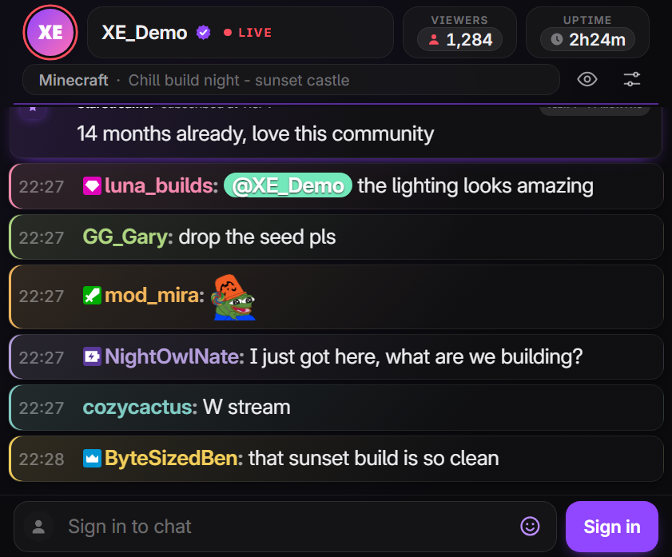
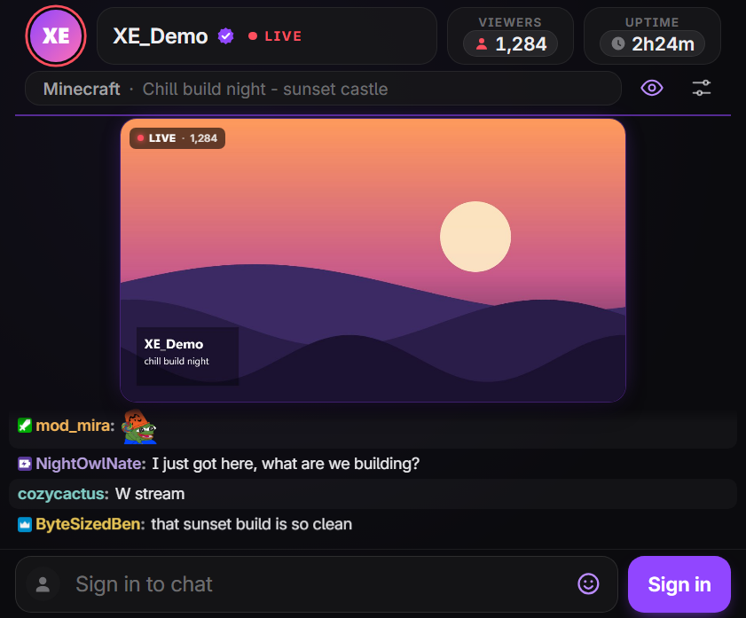
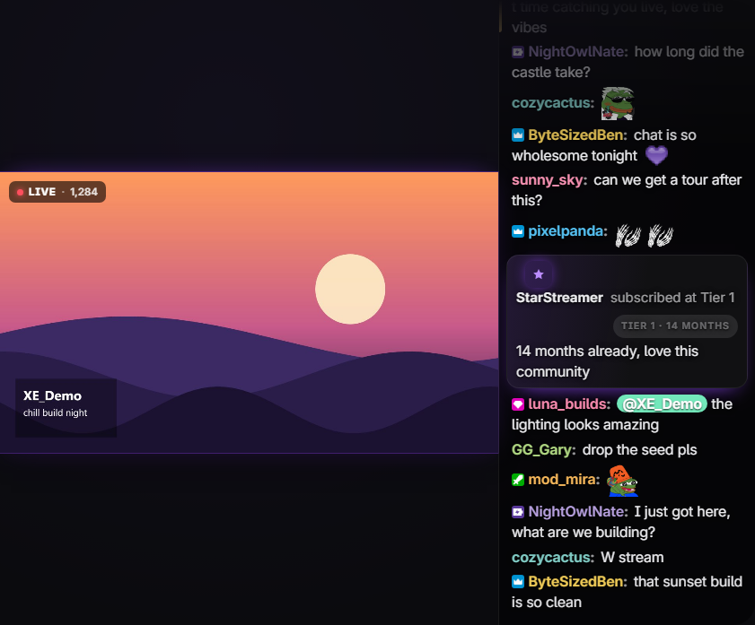
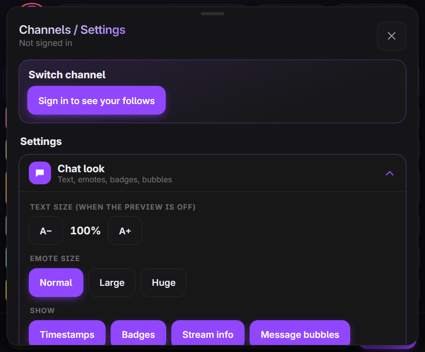
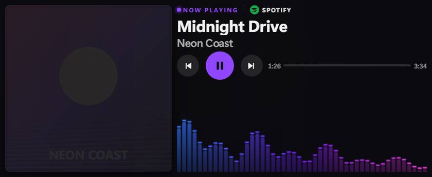

# XE Widgets

Touch-friendly Twitch chat and a now-playing audio visualizer for the **Corsair Xeneon Edge** (iCUE 5 HTML widgets).

A vibe-coded fork by **Tkalva**: XE Chat started as a rework of the Lumo chat widget, and XE Visualizer and its companion server grew out of QuadraKev's QK XE Visualizer. Both were rebuilt from the ground up for speed, touch and a cleaner look on the Edge.

  
  
  

| Widget | What it does |
|---|---|
| **XE Chat** | Twitch chat with 7TV / BTTV / FFZ emotes, 7TV name paints and badges, stream info, chatting and moderation once you sign in, your followed channels (live first), and a live stream preview with sound and a theater view. |
| **XE Visualizer** | Audio visualizer with the current song or video, album art, playback controls, themes and a bass pulse glow. YouTube videos get their HD thumbnail with a channel card (avatar, subscribers, likes, views); any other website shows its own name and icon. Works with Spotify, YouTube, Twitch and anything else Windows shows as "now playing". |

## Screenshots

  
  

  
  

  

XE Chat at the Edge's 841×697 size: chat · stream preview · theater view · settings menu. XE Visualizer at 840×344. Demo data, with made-up chatters and stream.

Both widgets talk to a small companion server that runs in your system tray. It relays Twitch chat (iCUE's browser can't reach Twitch directly), reads what's playing, captures audio for the visualizer and decodes the stream preview.

## Install

1. **Server** — download **[XE-Widgets-Server.exe](https://github.com/tkalva2-source/XE-Widgets/releases/latest/download/XE-Widgets-Server.exe)** and run it. It shows exactly what it will do and asks before installing. No Python or admin rights needed.
2. **Widgets** — download **[XE-Chat.icuewidget](https://github.com/tkalva2-source/XE-Widgets/releases/latest/download/XE-Chat.icuewidget)** and/or **[XE-Visualizer.icuewidget](https://github.com/tkalva2-source/XE-Widgets/releases/latest/download/XE-Visualizer.icuewidget)** and double-click them to add them to iCUE.
3. Add the widgets to your Xeneon Edge in iCUE.

> **"Windows protected your PC"?** The server isn't code-signed (that costs money), so SmartScreen may warn on first run. Click *More info → Run anyway*. You can check the download against the SHA256 hash listed on the release, or build it yourself from this repo (see below).

To update, run a newer `XE-Widgets-Server.exe`; it replaces the old one.

> iCUE's own settings page shows a small preview of each widget that doesn't match the real layout. Adjust XE Chat with the settings button on the widget itself.

## What the server installs

Running `XE-Widgets-Server.exe` asks first, then:

- copies itself to `%LOCALAPPDATA%\XEWidgets\XE-Widgets-Server.exe` (your user folder only, no admin rights),
- adds one startup entry (`HKCU\...\Run\XE Widgets Server`) so it starts with Windows — toggle it from the tray icon,
- runs in the system tray.

While running it:

- **only listens on your own PC** (`localhost:16329`), nothing is reachable from the network,
- connects to Twitch, 7TV, BetterTTV, FrankerFaceZ and ivr.fi for chat, emotes, badges and stream info,
- reads the "now playing" info Windows already shows (song, video, thumbnail) and captures audio for the visualizer,
- for YouTube videos, looks the video up on youtube.com by its title to get the HD thumbnail, channel avatar, subscriber, like and view counts,
- shows which website a video or song is playing on. Windows doesn't say which site a browser tab is, so the server finds the tab's page by its title in your browser's own local data (the same place the browser keeps its tab icons), entirely on your PC. It only looks for the page that's playing, never stores or uploads anything, and private windows are left alone,
- decodes the stream preview when you turn it on.

It collects nothing and sends nothing anywhere else. **Uninstall:** right-click the tray icon → *Uninstall…* (removes the program and its startup entry), then remove the widgets in iCUE.

## Signing in to Twitch (optional)

**Good news first: you don't need to sign in to use XE Chat.** Reading chat, emotes, 7TV paints, stream info and the stream preview all work straight away, no account needed.

Signing in is only for when you want to **type in chat, use moderation tools, or see the channels you follow**. It's a one-time setup that takes about 2 minutes, and you never have to do it again.

### Why do I need to make a "Twitch app"?

Twitch only lets programs sign you in if they've been registered with Twitch. Instead of everyone sharing one registration, XE Chat lets you use your **own** free one. That means:

- it's yours: nobody else's app ever touches your account,
- there's nothing to pay and nothing to publish,
- your password never goes anywhere near the widget (you approve the sign-in on Twitch's own website).

Don't worry about the word "developer" below. You're not writing any code, just filling in a short form.

### Step by step

1. **Open the Twitch developer console**: go to [dev.twitch.tv/console](https://dev.twitch.tv/console) and log in with your normal Twitch account.
   - The first time, Twitch may ask you to turn on two-factor authentication (2FA) before you can register an app. That's a Twitch rule; follow its prompts and come back.
2. Click **Register Your Application** and fill in the form:

   | Field | What to put |
   |---|---|
   | **Name** | Anything unique, e.g. `XE Chat yourname` |
   | **OAuth Redirect URLs** | `http://localhost` (it's required by the form but XE Chat doesn't use it) |
   | **Category** | *Chat Bot* (any category works) |
   | **Client Type** | **Public** ← this one matters |

   Click **Create**.
3. Back on the console, click **Manage** next to your new app and copy the **Client ID** (a long string of letters and numbers).
   - A Client ID isn't a password, but there's no need to post it anywhere either. If you ever see a **Client Secret**, you don't need it: never share that one.
4. **Give XE Chat the Client ID**, either way works:
   - tap **Sign in** on the widget and paste it into the box it shows, **or**
   - paste it into XE Chat's **Twitch Client ID** setting in iCUE.
5. **Sign in**: tap **Sign in** on the widget. It shows a short code. On your PC or phone, go to [twitch.tv/activate](https://www.twitch.tv/activate), enter the code and click **Authorize**. The widget picks it up by itself within a few seconds.

You're done! The chat box is now live and the menu shows your follows.

### Good to know

- Your sign-in is saved **only on your PC**, and refreshes itself automatically.
- **Sign out** any time from the widget's menu (*Twitch account → Sign out*), or remove access completely at [twitch.tv/settings/connections](https://www.twitch.tv/settings/connections).
- Moderation tools only appear in channels where you're a moderator (or your own).
- **"Twitch rejected the Client ID"?** Check the app's *Client Type* is **Public**, and that the XE Widgets server is running (tray icon). XE Chat signs in through it.

## Audio source (visualizer)

By default the visualizer follows SteelSeries Sonar's *Media* and *Aux* channels if you use Sonar, and otherwise your default Windows output. Change it with the visualizer's **Audio Source** setting in iCUE.

## Troubleshooting

- **Chat says it's connecting / nothing loads** — make sure the server is running (tray icon). If not, run `XE-Widgets-Server.exe` again.
- **Widgets don't show up in iCUE** — restart iCUE after adding them.
- **Server port** — both widgets use port `16329`. If you change it, change it in both widgets' settings.
- If there is an error with the preview try switching to another stream and back

## Build it yourself

Want to see the widgets without installing anything? Run `python -m http.server` in this folder and open `http://localhost:8000/tools/demo.html` (chat, with `?view=preview`, `theater` or `menu`) or `/tools/demo-visualizer.html`. They use made-up data.

Everything in the release is built from this repo. With Python 3.10+ installed, run `build-release.ps1`; it produces the server exe (via PyInstaller) and both `.icuewidget` files in `dist\`, and prints their SHA256 hashes. To run the server from source instead: `pip install -r server/requirements.txt`, then `pythonw server/NowPlayingServer.pyw`.

## Notes

- Not affiliated with Corsair, Twitch, 7TV, BetterTTV or FrankerFaceZ.
- The stream preview uses the same public player access Twitch's own web player uses. Twitch may change it at any time.
- Emote, badge and profile data come from the public 7TV, BetterTTV, FrankerFaceZ and ivr.fi APIs.

## Credits

- Made by **Tkalva**, vibe coded with Claude.
- XE Chat is a fork of the **Lumo** Twitch chat widget for iCUE.
- XE Visualizer and the companion server build on **QuadraKev**'s original QK XE Visualizer and Now Playing server.
- Inter typeface by Rasmus Andersson, SIL Open Font License (`widgets/xe-chat/fonts/LICENSE.txt`).

## License

MIT, see [LICENSE](LICENSE).
